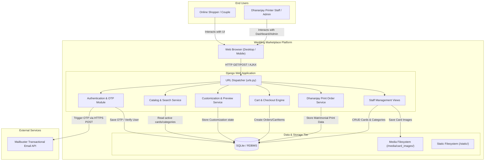
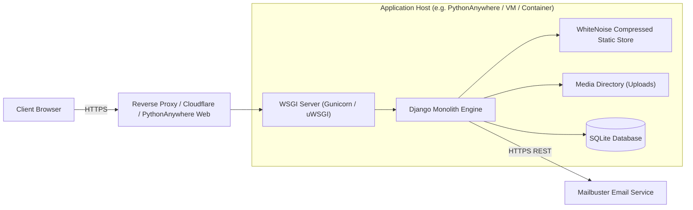

# System Architecture Document — Arts By Graphic (Vows & Blooms)
**Project:** Wedding Card Marketplace & Dhananjay Printer Order System  
**Codebase Location:** `wedding_marketplace/wedding_marketplace`  
**Framework:** Django 4.2+ (Python 3.8+)  
**Architectural Style:** Monolithic Model-View-Template (MVT) with Client-Side Interactive Augmentation  

---

## 1. Executive Summary & Architectural Overview

The **Arts By Graphic (Vows & Blooms)** platform is a full-featured wedding card commerce and custom printing management system. The architecture is built as a cohesive Django Monolith designed to serve two primary business vectors:
1. **Digital / Designer E-Commerce Marketplace**: Allows users to explore curated wedding stationery collections filtered by tradition/culture (Hindu, South Indian, Muslim, Sikh, etc.) and visual palette, customize templates with real-time browser preview, and order stationery in commercial volume.
2. **Traditional Indian Print Shop Order System (Dhananjay Printers)**: A specialized, bilingual (Hindi Devanagari & English) workflow tailored to Indian wedding ceremonies, collecting structured matrimonial details (Bride/Groom variants, Tilak, Sagaai, Ghudchadi, Barat swagat/prasthan, Vivah sthal, Reception, Darshanaabhilashi, Bal aakanksha) and outputting print-ready stationery artifacts.

---

## 2. Architectural Paradigm & Style

The system adopts a **Model-View-Template (MVT)** architectural pattern, standard in the Django framework, combined with **progressive client-side interactivity** (Vanilla JavaScript, CSS3 3D transforms, and asynchronous search APIs).

```
+------------------------------------------------------------------------------------+
|                                    CLIENT TIER                                     |
|  - Modern Web Browsers (Desktop & Mobile)                                          |
|  - 3D Coverflow Stage (CSS 3D perspective / transforms)                            |
|  - Live Card Customization Engine (DOM mutation & Canvas preview)                  |
|  - Debounced Autocomplete & Search Client                                          |
|  - Devanagari Print-Optimized Stylesheet Engine                                    |
+------------------------------------------------------------------------------------+
                                         ▲
                                         │ HTTP(S) / REST JSON / Form Submissions
                                         ▼
+------------------------------------------------------------------------------------+
|                         WEB APPLICATION TIER (Django Monolith)                     |
|                                                                                    |
|  [Entry Point: WSGI Handler (PythonAnywhere / Gunicorn / Dev Server)]               |
|                                                                                    |
|  +──────────────────────────────────────────────────────────────────────────────+  |
|  | Middleware Pipeline:                                                         |  |
|  | SecurityMiddleware ➔ WhiteNoise ➔ SessionMiddleware ➔ CommonMiddleware ➔     |  |
|  | CsrfViewMiddleware ➔ AuthenticationMiddleware ➔ MessageMiddleware ➔ XFrame   |  |
|  +──────────────────────────────────────────────────────────────────────────────+  |
|                                                                                    |
|  +─────────────────────────+  +─────────────────────────+  +────────────────────+  |
|  | Presentation (Templates)|  | Controllers (Views)     |  | Form Layer (Forms) |  |
|  | - base.html             |  | - Marketplace & Detail  |  | - Customization    |  |
|  | - home.html (3D cover)  |  | - Cart & Checkout       |  | - PrinterCardOrder |  |
|  | - customize.html        |  | - 3-Step OTP Auth       |  | - UserRegistration |  |
|  | - printer_card_*.html   |  | - Dashboard & Admin     |  | - ReviewForm       |  |
|  +─────────────────────────+  +─────────────────────────+  +────────────────────+  |
|                                                                                    |
|  +──────────────────────────────────────────────────────────────────────────────+  |
|  | Service & Integration Layer:                                                 |  |
|  | - Mailbuster REST Client (Transactional OTP Email)                           |  |
|  | - Django Console/SMTP Fallback Engine                                        |  |
|  | - Slugify & Media Processing (Pillow)                                        |  |
|  +──────────────────────────────────────────────────────────────────────────────+  |
|                                                                                    |
|  +──────────────────────────────────────────────────────────────────────────────+  |
|  | Data Access Layer (Django ORM):                                              |  |
|  | - Category, WeddingCard, Customization, CartItem, Order, OrderItem           |  |
|  | - PrinterCardOrder, EmailOTP, auth_user                                      |  |
|  +──────────────────────────────────────────────────────────────────────────────+  |
+------------------------------------------------------------------------------------+
                                         ▲
                                         │ SQL Queries / File I/O / HTTPS Outbound
                                         ▼
+------------------------------------------------------------------------------------+
|                       PERSISTENCE & EXTERNAL SERVICES TIER                         |
|                                                                                    |
|  +─────────────────────────+  +─────────────────────────+  +────────────────────+  |
|  | Relational Database     |  | Local / Media Storage   |  | External Mailer    |  |
|  | - SQLite3 (Default/Dev) |  | - /media/card_images/   |  | - Mailbuster API   |  |
|  | - PostgreSQL (Prod-ready|  | - /static/ assets       |  |   (Transactional   |  |
|  |   via Django DB Engine) |  | - WhiteNoise Compressed |  |    HTTP POST)      |  |
|  +─────────────────────────+  +─────────────────────────+  +────────────────────+  |
+------------------------------------------------------------------------------------+
```

---

## 3. Layered Component Architecture

### 3.1. Client / Presentation Tier
- **Django Template Engine (DTL)**: Server-side rendering using an inheritance hierarchy rooted at `templates/base.html`.
- **Styling Architecture**: Custom CSS custom properties (`:root` theme tokens for colors like `--cream`, `--gold`, `--rose`, `--deep`), typography pairing (Cormorant Garamond serif + Jost sans-serif + Noto Serif/Sans Devanagari).
- **Client Components**:
  - **3D Coverflow Stage**: CSS 3D perspectives (`perspective: 1000px`, `transform-style: preserve-3d`) with dynamic indexing.
  - **Dynamic Card Customizer**: Interactive two-way preview updating live names, dates, venues, ornaments, typography, and card dimensions in real time.
  - **Live Search Autocomplete**: Debounced (280ms) AJAX client consuming `/search-suggestions/`.
  - **Print Layout Engine**: Specialized CSS media queries for printing Indian card proofs directly from browser (`@media print`).

### 3.2. Middleware Pipeline
1. `SecurityMiddleware`: Handles standard security headers and SSL redirection.
2. `WhiteNoiseMiddleware`: Serves static assets directly with gzip/Brotli compression and content hashing.
3. `SessionMiddleware`: Manages HTTP session state in database backing store (`django_session`).
4. `CommonMiddleware`: Handles canonical URL redirection and user-agent normalizations.
5. `CsrfViewMiddleware`: Enforces CSRF token validation on state-modifying requests (`POST`).
6. `AuthenticationMiddleware`: Resolves session cookie to `User` instance in `request.user`.
7. `MessageMiddleware`: Cookie/session-based flash message queue (`django.contrib.messages`).
8. `XFrameOptionsMiddleware`: Protects against clickjacking.

### 3.3. Application / Business Logic Layer (`cards` app)
- **Catalog & Discovery**: View controllers managing catalog queries, category slicing, palette filtering, and full-text keyword searches.
- **Stationery Customization Controller**: Manages font pairings, color palettes, and structured typography configurations.
- **Cart & Order Processing**: Calculates line subtotals, validates commercial minimum batch size (minimum 100 units), converts cart records to immutable orders and order items.
- **Dhananjay Printer Order Processing**: Validates cultural-specific ceremony timings, addresses, and print details; saves distinct bride and groom records.
- **3-Step OTP Registration Engine**: A resilient multi-step session-backed state machine for spam-free user onboarding.
- **Staff Merchant Management**: Administrative card and category upload interface (`admin_upload_collection`) with instant toggle, image upload, and deletion hooks.

### 3.4. Persistence & External Integration Layer
- **Django ORM**: Object-Relational Mapper mapping models to SQL tables (`db.sqlite3` / PostgreSQL compatible).
- **Mailbuster API Service**: REST-based transactional email delivery with HTML email templating and fallback to Django's native email backends.
- **Static & Media Asset Handling**: Pillow engine for dynamic image rendering and WhiteNoise for production static distribution.

---

## 4. Component Interaction Diagram (C4 Container View)



---

## 5. Technology Stack Breakdown

| Layer | Technology | Version | Purpose |
| :--- | :--- | :--- | :--- |
| **Backend Framework** | Django | 4.2+ (up to 5.x) | Web framework, ORM, URL routing, authentication, templating |
| **Language Runtime** | Python | 3.8+ | Backend execution environment |
| **Imaging Library** | Pillow | 10.0+ | Card template image verification, thumbnailing, and validation |
| **Static File Server**| WhiteNoise | 6.6+ | Production static asset serving without separate Nginx requirement |
| **HTTP Client** | Requests | 2.31+ | Transactional email payload delivery to external REST endpoints |
| **Database** | SQLite 3 | Embedded | Default persistent store for orders, users, catalog, OTPs |
| **External Email API**| Mailbuster API | REST v1 | High-deliverability transactional verification emails |
| **Frontend Foundation**| HTML5 / CSS3 / Vanilla JS | Modern ES6+ | Semantic layout, 3D perspective animation, reactive customization |
| **Typography** | Google Fonts | Cormorant Garamond, Jost, Noto Sans/Serif Devanagari | Elegant English typography paired with formal Hindi script |

---

## 6. Deployment & Infrastructure Architecture



### Key Deployment Characteristics:
- **Zero-Dependency Asset Serving**: By leveraging `WhiteNoise` with `CompressedManifestStaticFilesStorage`, static CSS, JS, and brand logos are compressed with unique hashes and served directly through Python WSGI workers without needing reverse proxy configuration.
- **PythonAnywhere Compatibility**: Preconfigured `CSRF_TRUSTED_ORIGINS` for `*.pythonanywhere.com` domains and dedicated host settings.
- **Production Switchable Database**: The application uses standard Django database configuration in `settings.py`, allowing drop-in upgrades to PostgreSQL or MySQL by setting environment variables without code modification.

