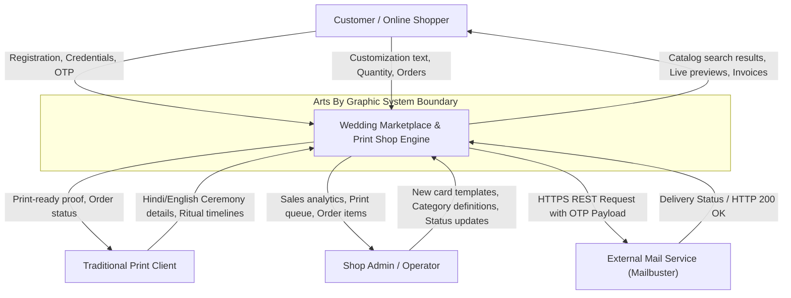
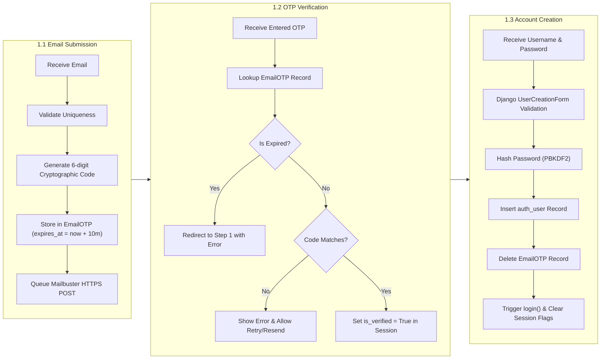
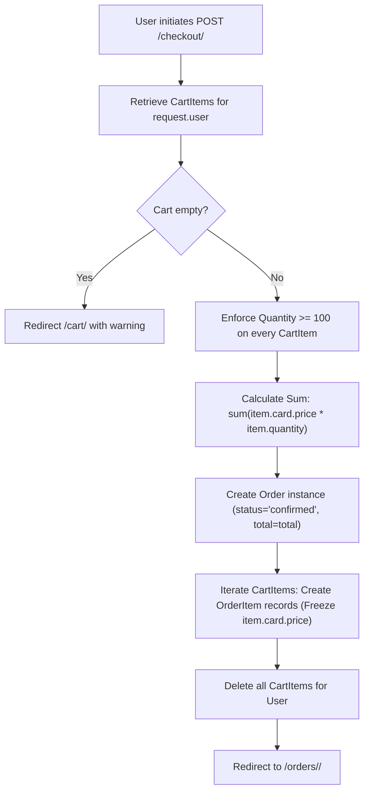

# Data Flow Diagrams (DFD) & Security Architecture Document
**System Name:** Arts By Graphic (Vows & Blooms) — Wedding Card Marketplace  
**Document Type:** DFD (Level 0, 1, 2) & Threat Modeling (STRIDE)  
**Location:** `wedding_marketplace/wedding_marketplace/docs/DATA_FLOW_AND_SECURITY.md`  

---

## 1. Data Flow Diagrams (DFD)

### 1.1 DFD Level 0 — Context Diagram
The Level 0 context diagram defines the boundary of the system, identifying external entities and high-level data exchanges.



---

### 1.2 DFD Level 1 — Core Process Decomposition

```mermaid
flowchart TD
    User["End User (Shopper / Client)"]
    AdminUser["Merchant / Admin"]

    subgraph Processes["System Processes"]
        P1["1.0 Identity & OTP Auth"]
        P2["2.0 Catalog & Search Engine"]
        P3["3.0 Interactive Customization"]
        P4["4.0 Cart & Batch Checkout"]
        P5["5.0 Dhananjay Print Processing"]
        P6["6.0 Staff Inventory & Curation"]
    end

    subgraph DataStores["Data Stores"]
        D1[("D1: auth_user & EmailOTP")]
        D2[("D2: Catalog & Categories")]
        D3[("D3: Customizations")]
        D4[("D4: Cart & Orders")]
        D5[("D5: PrinterCardOrders")]
        D6[("D6: Media Storage")]
    end

    subgraph External["External Services"]
        MailAPI["Mailbuster API"]
    end

    User -->|Email / Code| P1
    P1 <-->|Verify / Store OTP| D1
    P1 -->|Dispatch OTP Code| MailAPI

    User -->|Filter / Query| P2
    P2 <-->|Fetch Active Cards| D2

    User -->|Personalization Inputs| P3
    P3 <-->|Read Template Metadata| D2
    P3 -->|Store Configuration| D3

    User -->|Batch Quantity (>=100)| P4
    P4 <-->|Link Customization & Card| D3
    P4 <-->|Manage Cart & Snapshot Prices| D4

    User -->|Bilingual Matrimonial Details| P5
    P5 -->|Save Ritual Order| D5

    AdminUser -->|Upload Image & Template| P6
    P6 -->|Write Metadata| D2
    P6 -->|Save Images| D6
    AdminUser -->|Update Fulfillment State| P4
    AdminUser -->|Update Print State| P5
```

---

### 1.3 DFD Level 2 — Detailed Sub-Processes

#### 1.3.1 Level 2 Process: 3-Step OTP Authentication Flow


#### 1.3.2 Level 2 Process: Cart to Immutable Checkout Flow


---

## 2. Security Architecture & Threat Model (STRIDE)

### 2.1 Security Boundary Definition
The application enforces three distinct security perimeters:
1. **Public Perimeter**: Anonymous users browsing catalog, viewing card details, searching suggestions, and initiating registration.
2. **Authenticated Customer Perimeter**: Logged-in users managing customizations, viewing private carts, submitting checkout orders, and inspecting personal order history.
3. **Staff / Merchant Perimeter**: Elevated staff users modifying catalog items, category taxonomies, and updating order fulfillment statuses.

---

### 2.2 STRIDE Threat Modeling Analysis

| STRIDE Category | Identified Threat | Risk Level | Existing Architecture Control | Recommended Enhancement |
| :--- | :--- | :--- | :--- | :--- |
| **Spoofing** | Adversary registers arbitrary accounts or bypasses email verification. | Medium | 3-step OTP with 10-minute expiry; session binds verified email to account creation. | Implement IP-based rate limiting on `register_step1` and `resend_otp` (e.g. max 5 OTPs per IP per hour). |
| **Tampering** | User tampers with card price or quantity parameters in HTTP POST. | High | **Quantity**: Enforced server-side (`qty = max(100, qty)` in both cart and checkout).<br>**Price**: Price is queried server-side from `WeddingCard.price`, never accepted from client form input. | Add DB constraint `CheckConstraint(check=Q(quantity__gte=100))` on `CartItem` and `OrderItem`. |
| **Repudiation** | User denies placing an order or print request. | Low | Orders record persistent timestamps (`created_at`, `updated_at`), linked `user_id`, snapshotted pricing, and session records. | Maintain audit log entries for status transitions from `pending` to `delivered`. |
| **Information Disclosure** | IDOR (Insecure Direct Object Reference) allowing users to view other customers' orders or print submissions. | High | **Orders**: `get_object_or_404(Order, pk=pk, user=request.user)` strictly scopes query to requesting user.<br>**Print Orders**: Protected by ownership verification `if order.user and order.user != request.user and not request.user.is_staff: redirect(...)`. | Reject unauthorized print order queries with HTTP 403 Forbidden rather than silent redirect. |
| **Denial of Service (DoS)** | Automated bots repeatedly triggering Mailbuster API by submitting mass OTP requests. | Medium | Email validation and existence check before OTP dispatch. | Add reCAPTCHA / Cloudflare Turnstile or session rate-limiting bucket on `/register/step1/`. |
| **Elevation of Privilege** | Normal user attempting to access merchant collection uploader (`/admin-upload/`). | High | View protected by `@staff_member_required`, which verifies `request.user.is_active` and `request.user.is_staff`. | Restrict access to Django admin URL `/admin/` via reverse proxy firewall or VPN in production. |

---

### 2.3 Cross-Cutting Security Controls Matrix

```
+───────────────────────────────────────────────────────────────────────────────────+
|                           CROSS-CUTTING SECURITY MATRIX                           |
+──────────────────────────┬────────────────────────────────────────────────────────+
| CSRF Defense             | Enabled via Django `CsrfViewMiddleware`. Every POST     |
|                          | template includes ``.                  |
+──────────────────────────┼────────────────────────────────────────────────────────+
| Session Security         | `SESSION_COOKIE_HTTPONLY = True` (mitigates XSS token  |
|                          | exfiltration). `SESSION_COOKIE_AGE = 7 days`.          |
|                          | `SESSION_SAVE_EVERY_REQUEST = True`.                   |
+──────────────────────────┼────────────────────────────────────────────────────────+
| Injection Defense        | SQL Injection prevented by Django ORM parameterized     |
|                          | queries. Template auto-escaping prevents HTML/XSS.    |
+──────────────────────────┼────────────────────────────────────────────────────────+
| Media Upload Security    | Validated through Django `ImageField` and `Pillow`.    |
|                          | Auto-stored in segregated `/media/card_images/`.       |
+──────────────────────────┼────────────────────────────────────────────────────────+
| Production Hardening     | WhiteNoise with content hashing and compression.       |
|                          | Custom 403 and 404 handlers preventing stack leaks.   |
+──────────────────────────┴────────────────────────────────────────────────────────+
```

