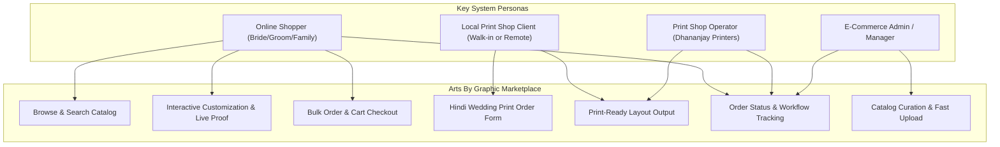
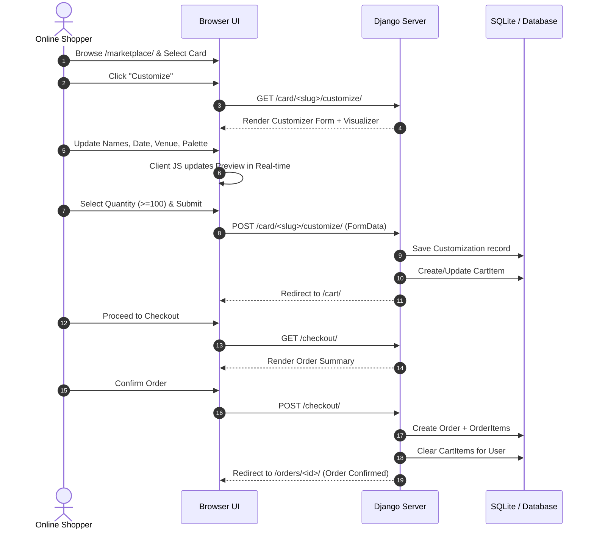
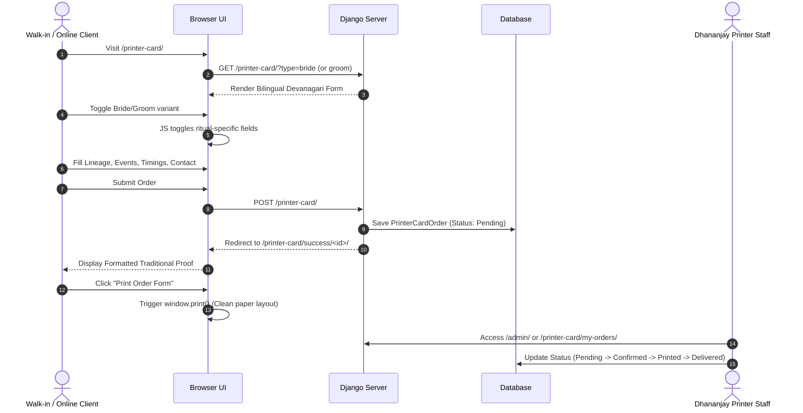

# High-Level Design (HLD) Document — Arts By Graphic (Vows & Blooms)
**System Name:** Wedding Card Marketplace & Dhananjay Printer Order System  
**Version:** 1.0.0  
**Target Audience:** Architects, Software Engineers, Product Managers, QA Engineers  

---

## 1. System Goals & Problem Statement

### 1.1 Context
In the traditional stationery and print industry, wedding invitation ordering is fragmented:
- Customers browsing online digital stationery lack real-time visual proofing.
- Traditional Indian print shops require manual in-person dictation of extensive wedding rituals (Devanagari text, family lineage, event timelines), leading to typesetting errors and delays.

### 1.2 System Purpose
The **Arts By Graphic** platform unifies digital e-commerce stationery with an end-to-end traditional printing system:
1. Provide an aesthetic digital marketplace with cultural categorization (Hindu, South Indian, Muslim, Christian, Sikh, Rajasthani, Bengali, Marathi, Generic).
2. Offer instant live customization with dynamic font selection, aesthetic palettes, layout orientations, and ornament motifs.
3. Automate physical order collection for traditional print shops (Dhananjay Printers) with specialized ritual fields and print-ready templates.
4. Guarantee account authenticity via a resilient 3-step Email OTP verification mechanism.

---

## 2. Key Personas & System Boundary



| Persona | Primary Needs & Responsibilities | Key Touchpoints |
| :--- | :--- | :--- |
| **Online Shopper** | Discover wedding stationery, personalize with spouse & event details, order in volume (≥ 100 units). | `/marketplace/`, `/card/<slug>/customize/`, `/cart/`, `/checkout/` |
| **Traditional Print Client** | Submit detailed Indian wedding ritual data in Hindi/English with ceremony logistics. | `/printer-card/`, `/printer-card/success/<pk>/` |
| **Printer Staff** | Access structured print orders, inspect family names and ceremony schedules, print cards. | `/printer-card/my-orders/`, Django Admin, `/printer-card/success/<id>/` |
| **Store Admin** | Manage stationery designs, update pricing, assign featured cards, upload banner images. | `/admin-upload/`, `/admin/` |

---

## 3. High-Level Functional Modules

```
+───────────────────────────────────────────────────────────────────────────────────+
|                                    CORE SYSTEM                                    |
+─────────────────────────────────────────┬─────────────────────────────────────────+
| 1. MARKETPLACE & CATALOG MODULE         | 2. LIVE CUSTOMIZATION ENGINE            |
| - 3D Coverflow Hero showcase            | - Real-time typography switching        |
| - Cultural Category Filtering           | - Color palette theme styling           |
| - Color Palette selector                | - Orientation adjustment                |
| - Debounced Live Autocomplete           | - Live DOM & Canvas proofing            |
+─────────────────────────────────────────┼─────────────────────────────────────────+
| 3. COMMERCE & ORDER MANAGEMENT          | 4. DHANANJAY PRINTER MODULE             |
| - Multi-item Shopping Cart              | - Bride/Groom variant toggle            |
| - Min. 100-unit batch enforcement       | - Hindi ceremony fields (Sagaai, Barat) |
| - Subtotal & Grand Total computation    | - Lineage & RSVP details collection     |
| - Lifecycle order state machine         | - Direct-to-paper browser print mode    |
+─────────────────────────────────────────┼─────────────────────────────────────────+
| 5. 3-STEP OTP AUTHENTICATION            | 6. ADMINISTRATIVE & SEEDING TOOLS       |
| - Step 1: Email capture & OTP trigger   | - Rapid collection uploader             |
| - Step 2: 10-minute validity OTP check  | - Category creator & toggle switch      |
| - Step 3: Account creation & auto-login | - Seed command with 18 cultural cards   |
| - Mailbuster API + Console fallback     | - Order status transition control       |
+─────────────────────────────────────────┴─────────────────────────────────────────+
```

### Module 1: Marketplace & Catalog Discovery
- **3D Coverflow Presentation**: Presents top featured cards in a 3D stage with z-depth and responsive touch/click navigation.
- **Filtering & Search**:
  - Filter by Cultural Categories: `hindu`, `south-indian`, `muslim`, `christian`, `sikh`, `bengali`, `marathi`, `rajasthani`, `generic`.
  - Filter by Aesthetic Palettes: `floral`, `botanical`, `gold`, `minimal`, `classic`, `rustic`.
  - Sort by: Newest, Price (Ascending/Descending), Popularity (Rating).
  - Search: Full-text search across card name, category name, and descriptions with AJAX autocomplete dropdown.

### Module 2: Live Stationery Customizer
- **WYSIWYG Interactive Personalizer**: Users edit bride/groom names, ceremony date, venue, typography (`Cormorant Garamond`, `Jost`, `Georgia`), card orientation (`Portrait`, `Landscape`, `Square`), and decorative motif.
- **Dual Visualizer**: Supports previewing standard digital layout as well as traditional print card preview.
- **Cart Bridge**: Automatically bundles customized options with the selected card before queuing into the user's cart.

### Module 3: Cart, Checkout & Commercial Batch Engine
- **Commercial Batch Sizing**: Wedding invitations are industrial print orders; a strict minimum threshold of **100 cards per item** is enforced at customizer, cart, and checkout stages.
- **Cart Management**: Real-time quantity steppers (increments of 50), item removal, subtotal calculation, and persistence across user sessions.
- **Checkout & Order Creation**: Generates persistent immutable `Order` and `OrderItem` records with unit prices snapshotted at time of purchase.

### Module 4: Traditional Dhananjay Printer Form
- **Bilingual Matrimonial Form**: A dedicated single-page application form optimized for Indian wedding traditions.
- **Dynamic Bride / Groom Morphing**:
  - *Bride Form (`लड़की का कार्ड`)*: Captures Barat Swagat, Shaadi Preetibhoj, Vivah Sthal.
  - *Groom Form (`लड़के का कार्ड`)*: Captures Ghudchadi, Barat Prasthan, Barat Destination, Reception Date & Preetibhoj.
- **Lineage Details**: Captures Dada (grandfather), Pita (father), and family address.
- **Print Confirmation View**: Generates a print-optimized document (`@media print`) matching traditional card dimensions with auspicious emblems (`卐`, `ॐ`).

### Module 5: 3-Step Secure OTP Authentication
- Designed to eliminate fake registrations while removing friction:
  1. **Step 1**: User submits email; system generates a secure 6-digit cryptographic OTP valid for 10 minutes.
  2. **Step 2**: User enters the code received via email; verified status is stamped on the session.
  3. **Step 3**: User sets username and password; user is created, immediately logged in, and redirected to their previous flow.
- **Dual Mail Delivery**: Primary transmission via Mailbuster REST API; automatic fail-safe fallback to Django console/local email backend.

### Module 6: Merchant Suite & Dashboard
- **Dashboard (`/dashboard/`)**: Central customer hub displaying total orders, total expenditure, print submissions, customizations, and recent activity.
- **Admin Upload Suite (`/admin-upload/`)**: Dedicated merchant portal for quick card publishing, category creation, active/featured toggling, and image uploads without navigating complex Django admin menus.

---

## 4. End-to-End User Journeys

### 4.1 Digital Card Personalization & Checkout Flow



### 4.2 Traditional Indian Print Order Workflow



---

## 5. Non-Functional Requirements (NFRs)

| Dimension | Target Specification | Architectural Implementation |
| :--- | :--- | :--- |
| **Performance** | Page load < 1.2s on standard broadband; search latency < 150ms. | Server-side template rendering, debounced AJAX live search (`280ms`), indexed foreign keys and slugs, WhiteNoise compressed static assets. |
| **Security** | Zero unauthorized access to user orders; prevention of automated account spam. | CSRF tokens on all POST endpoints, `@login_required` decorators, user-ownership checks in views (`order.user == request.user`), hashed passwords (PBKDF2), 10-minute expiring single-use OTPs. |
| **Usability** | Seamless experience on desktop and mobile; bilingual clarity. | Responsive CSS grid and flexbox layouts; Hindi Devanagari web fonts (`Noto Serif Devanagari`) paired with modern English serifs. |
| **Reliability** | Zero transactional email drops blocking user onboarding. | Resilient OTP email sender: tries Mailbuster HTTP API first; if unavailable or timeout occurs, safely falls back to Django email backend without blocking HTTP request. |
| **Data Integrity** | Historical orders must not mutate if catalog items change price or are deactivated. | `OrderItem` snapshots unit `price` at checkout; `Customization` records are distinct from template `WeddingCard` records. |

---

## 6. URL Routing Specification & Route Map

| URL Pattern | View Function | HTTP Method | Access Level | Description |
| :--- | :--- | :--- | :--- | :--- |
| `/` | `views.home` | GET | Public | Homepage, 3D Coverflow, featured cards, categories |
| `/marketplace/` | `views.marketplace` | GET | Public | Full catalog with category, palette, search, sort |
| `/card/<slug>/` | `views.card_detail` | GET, POST | Public (POST Auth) | Card showcase, reviews, review submission |
| `/card/<slug>/customize/` | `views.customize_card` | GET, POST | Authenticated | Live personalizer and cart addition |
| `/cart/` | `views.cart` | GET, POST | Authenticated | View cart, update quantities (step 50, min 100) |
| `/cart/remove/<int:item_id>/` | `views.remove_from_cart`| GET | Authenticated | Remove line item from cart |
| `/checkout/` | `views.checkout` | GET, POST | Authenticated | Review order, place and confirm order |
| `/orders/` | `views.orders` | GET | Authenticated | Order history for current user |
| `/orders/<int:pk>/` | `views.order_detail` | GET | Authenticated | Detailed view of a single order and customized cards |
| `/printer-card/` | `views.printer_card_form`| GET, POST | Public / Auth | Dhananjay Printer bilingual matrimonial form |
| `/printer-card/success/<pk>/` | `views.printer_card_success`| GET | Owner / Staff | Printable proof card confirmation |
| `/printer-card/my-orders/` | `views.my_printer_orders`| GET | Authenticated | User's list of print orders |
| `/register/step1/` | `views.register_step1` | GET, POST | Public | Email submission and OTP generation |
| `/register/step2/` | `views.register_step2` | GET, POST | Session State | OTP entry and verification |
| `/register/step2/resend/` | `views.resend_otp` | GET | Session State | Request new 6-digit OTP code |
| `/register/step3/` | `views.register_step3` | GET, POST | Session Verified | Choose username and password, create account |
| `/login/` / `/logout/` | Django Auth / `custom_logout`| GET, POST | Public / Auth | Authentication lifecycle |
| `/dashboard/` | `views.dashboard` | GET | Authenticated | Account dashboard with metrics and summaries |
| `/admin-upload/` | `views.admin_upload_collection`| GET, POST | Staff Only | Rapid card creation, category creation, status toggle |
| `/search-suggestions/` | `views.search_api` | GET | Public | JSON endpoint for live header autocomplete |
| `/about/`, `/contact/` | `views.about`, `views.contact` | GET, POST | Public | Brand narrative and customer inquiry form |

