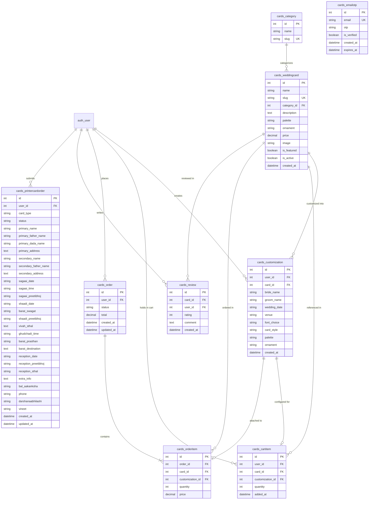
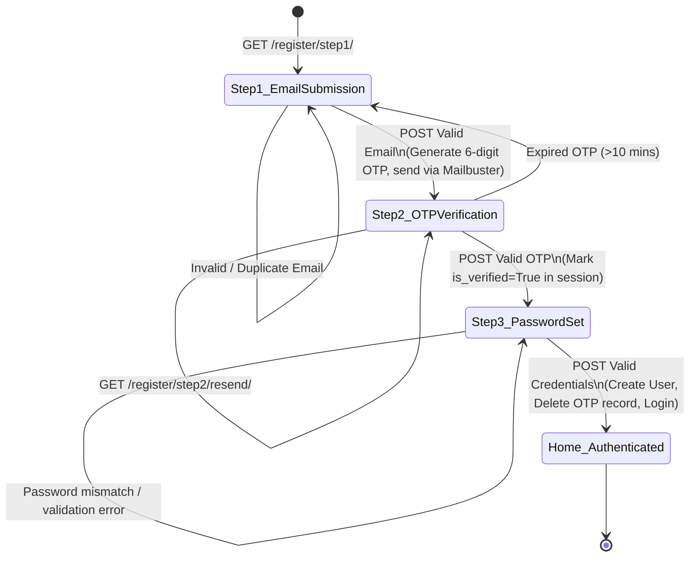

# Low-Level Design (LLD) Document — Arts By Graphic (Vows & Blooms)
**System Name:** Wedding Card Marketplace & Dhananjay Printer Order System  
**Version:** 1.0.0  
**Target Audience:** Backend Developers, Full-Stack Engineers, Database Administrators  

---

## 1. Database Schema & Entity-Relationship Model

### 1.1 Complete ER Diagram



---

## 2. Detailed Data Dictionary & Model Specifications

### 2.1 Model: `Category`
Represents cultural or thematic categories of invitations.
- **Table Name:** `cards_category`
- **Fields:**
  - `id`: `BigAutoField`, Primary Key, Auto Increment.
  - `name`: `CharField(max_length=100)`. Display name (e.g. "Hindu", "South Indian", "Muslim").
  - `slug`: `SlugField(unique=True)`. URL identifier (e.g. `hindu`, `south-indian`).
- **Meta Options:** `verbose_name_plural = 'Categories'`.

### 2.2 Model: `WeddingCard`
Core catalog stationery item.
- **Table Name:** `cards_weddingcard`
- **Fields:**
  - `id`: `BigAutoField`, Primary Key.
  - `name`: `CharField(max_length=200)`. Product title.
  - `slug`: `SlugField(unique=True)`. Clean URL path slug.
  - `category`: `ForeignKey(Category, on_delete=SET_NULL, null=True, related_name='cards')`.
  - `description`: `TextField(blank=True)`. Rich textual details.
  - `palette`: `CharField(max_length=20, choices=PALETTE_CHOICES, default='floral')`. Choices:
    - `'floral'`: Blush Floral
    - `'botanical'`: Forest Botanical
    - `'gold'`: Midnight Gold
    - `'minimal'`: Soft Minimal
    - `'classic'`: Classic Purple
    - `'rustic'`: Earthy Rustic
  - `ornament`: `CharField(max_length=10, default='❦')`. Default motif character.
  - `price`: `DecimalField(max_digits=8, decimal_places=2)`. Base unit price in ₹ (INR).
  - `image`: `ImageField(upload_to='card_images/', blank=True, null=True)`.
  - `is_featured`: `BooleanField(default=False)`. Prioritizes card in coverflow and homepage.
  - `is_active`: `BooleanField(default=True)`. Soft-delete / availability toggle.
  - `created_at`: `DateTimeField(auto_now_add=True)`.
- **Computed Properties:**
  - `average_rating`: Computes arithmetic mean of all related `Review` instances rounded to 1 decimal place (`round(sum(r.rating) / count, 1)`), or `0` if no reviews exist.
  - `get_absolute_url()`: Returns `reverse('card_detail', kwargs={'slug': self.slug})`.

### 2.3 Model: `Review`
Customer ratings and testimonials.
- **Table Name:** `cards_review`
- **Fields:**
  - `card`: `ForeignKey(WeddingCard, on_delete=CASCADE, related_name='reviews')`.
  - `user`: `ForeignKey(User, on_delete=CASCADE)`.
  - `rating`: `IntegerField(choices=[(1,1)..(5,5)])`. Star scale.
  - `comment`: `TextField()`. User feedback.
  - `created_at`: `DateTimeField(auto_now_add=True)`.
- **Constraints:** `unique_together = ('card', 'user')` (prevents multiple reviews from the same user for a single card).

### 2.4 Model: `Customization`
Stores the customized personalization parameters for a wedding invitation card.
- **Table Name:** `cards_customization`
- **Fields:**
  - `user`: `ForeignKey(User, on_delete=CASCADE, related_name='customizations')`.
  - `card`: `ForeignKey(WeddingCard, on_delete=CASCADE, related_name='customizations')`.
  - `bride_name`: `CharField(max_length=100)`.
  - `groom_name`: `CharField(max_length=100)`.
  - `wedding_date`: `CharField(max_length=100)`.
  - `venue`: `CharField(max_length=200, blank=True)`.
  - `font_choice`: `CharField(max_length=20, default='cormorant')`. Options: `'cormorant'`, `'jost'`, `'georgia'`.
  - `card_style`: `CharField(max_length=20, default='portrait')`. Options: `'portrait'`, `'landscape'`, `'square'`.
  - `palette`: `CharField(max_length=20, default='floral')`.
  - `ornament`: `CharField(max_length=10, default='❦')`.
  - `created_at`: `DateTimeField(auto_now_add=True)`.

### 2.5 Model: `CartItem`
Shopping cart line item before checkout.
- **Table Name:** `cards_cartitem`
- **Fields:**
  - `user`: `ForeignKey(User, on_delete=CASCADE, related_name='cart_items')`.
  - `card`: `ForeignKey(WeddingCard, on_delete=CASCADE)`.
  - `customization`: `ForeignKey(Customization, on_delete=SET_NULL, null=True, blank=True)`.
  - `quantity`: `PositiveIntegerField(default=1)`. (Validated to be ≥ 100 in view logic).
  - `added_at`: `DateTimeField(auto_now_add=True)`.
- **Computed Properties:**
  - `subtotal`: `self.card.price * self.quantity`.

### 2.6 Model: `Order` & `OrderItem`
Finalized, immutable purchase records.
- **Table Name:** `cards_order`
  - `user`: `ForeignKey(User, on_delete=CASCADE, related_name='orders')`.
  - `status`: `CharField(max_length=20, default='pending')`. Choices: `pending`, `confirmed`, `processing`, `delivered`, `cancelled`.
  - `total`: `DecimalField(max_digits=10, decimal_places=2)`.
  - `created_at`, `updated_at`: `DateTimeField`.
- **Table Name:** `cards_orderitem`
  - `order`: `ForeignKey(Order, on_delete=CASCADE, related_name='items')`.
  - `card`: `ForeignKey(WeddingCard, on_delete=CASCADE)`.
  - `customization`: `ForeignKey(Customization, on_delete=SET_NULL, null=True, blank=True)`.
  - `quantity`: `PositiveIntegerField(default=1)`.
  - `price`: `DecimalField(max_digits=8, decimal_places=2)`. Snapshotted unit price.
  - `subtotal`: `self.price * self.quantity`.

### 2.7 Model: `PrinterCardOrder`
Specialized Hindi Devanagari matrimonial order record for Dhananjay Printers.
- **Table Name:** `cards_printercardorder`
- **Fields:**
  - `user`: `ForeignKey(User, on_delete=CASCADE, null=True, blank=True)`. Optional link to registered account.
  - `card_type`: `CharField(max_length=10)`. Choices: `bride` (लड़की का कार्ड), `groom` (लड़के का कार्ड).
  - `status`: `CharField(max_length=20, default='pending')`. Choices: `pending`, `confirmed`, `printed`, `delivered`.
  - **Primary Person:** `primary_name`, `primary_father_name`, `primary_dada_name` (optional), `primary_address`.
  - **Secondary Person:** `secondary_name`, `secondary_father_name`, `secondary_address`.
  - **Engagement (सगाई):** `sagaai_date`, `sagaai_time`, `sagaai_preetibhoj`.
  - **Wedding (शादी):** `shaadi_date`.
  - **Bride-Specific:** `barat_swagat`, `shaadi_preetibhoj`, `vivah_sthal`.
  - **Groom-Specific:** `ghudchadi_time`, `barat_prasthan`, `barat_destination`, `reception_date`, `reception_preetibhoj`, `reception_sthal`.
  - **Ritual & Family Attribution:** `extra_info`, `bal_aakanksha`, `phone`, `darshanaabhilashi`, `vineet`.
  - `created_at`, `updated_at`: `DateTimeField`.
- **Meta:** `ordering = ['-created_at']`.

### 2.8 Model: `EmailOTP`
Transient authentication challenge store.
- **Table Name:** `cards_emailotp`
- **Fields:**
  - `email`: `EmailField(unique=True)`. Lowercase trimmed address.
  - `otp`: `CharField(max_length=6)`. 6-digit random numeric code.
  - `is_verified`: `BooleanField(default=False)`.
  - `created_at`: `DateTimeField(auto_now_add=True)`.
  - `expires_at`: `DateTimeField()`. Defaults to `created_at + 10 minutes`.
- **Methods:**
  - `is_expired()`: Returns `timezone.now() > self.expires_at`.
  - `generate_otp(email)`: Class method generating 6 random digits via `random.choices(string.digits, k=6)` and upserting the record with a fresh 10-minute expiry window.

---

## 3. Forms & Data Transfer Objects

| Form Class | Bound Model | Validated Fields | Custom Logic & Widgets |
| :--- | :--- | :--- | :--- |
| `CustomizationForm` | `Customization` | `bride_name`, `groom_name`, `wedding_date`, `venue`, `font_choice`, `card_style`, `palette`, `ornament` | `palette` and `ornament` mapped to `HiddenInput` (set via UI interaction); placeholder attributes injected. |
| `ReviewForm` | `Review` | `rating`, `comment` | Rating drop-down 1 to 5; comment formatted as 3-row textarea. |
| `UserRegistrationForm` | `User` | `username`, `password1`, `password2` | Extends Django's `UserCreationForm`. Strips email validation (email is enforced through session-backed OTP flow). Cleans up verbose Django password help text. |
| `PrinterCardOrderForm` | `PrinterCardOrder` | 24 ritual, contact, and lineage fields | Dynamic input styling helper `_fi()`; `card_type` as hidden field; telephone input mask for `phone`. |

---

## 4. View Controllers & Business Algorithms

### 4.1 Authentication & 3-Step OTP Workflow



#### Algorithm: `send_otp_email(email, otp_code)`
1. Always log the generated OTP to stdout/console (`print(f"OTP for {email}: {otp_code}")`) for local developer convenience and zero-block debugging.
2. Read `MAILBUSTER_API_KEY` from Django settings/environment.
3. If no key is set:
   - Call Django's native `send_mail` using `EMAIL_BACKEND` (which points to console in dev mode) and exit gracefully.
4. If key is present:
   - Construct styled HTML payload with dark brand card styling and spaced 42px monospace OTP display.
   - Dispatch `requests.post("https://api.mailbuster.io/api/send-email", json=payload, timeout=10)`.
   - Wrap in `try/except requests.exceptions.RequestException` to ensure network issues never throw 500 errors to the client.

#### Algorithm: `register_step3(request)`
1. Read `email = request.session.get('otp_verified_email')`. If absent, redirect to Step 1.
2. On `POST`:
   - Bind `form = UserRegistrationForm(request.POST)`.
   - If `form.is_valid()`:
     - `user = form.save(commit=False)`
     - Assign `user.email = email` and `user.is_active = True`.
     - Save user instance (hashes password via PBKDF2).
     - Clean up: `EmailOTP.objects.filter(email=email).delete()`.
     - Purge session keys: `pending_email` and `otp_verified_email`.
     - Authenticate against user database and call `login(request, auth_user)`.
     - Redirect to home with welcome flash message.

---

### 4.2 Marketplace Search & Filter Controller (`marketplace(request)`)

```mermaid
flowchart TD
    Req[Incoming HTTP Request] --> ParseParams[Extract: category, palette, q, sort]
    ParseParams --> BaseQuery[WeddingCard.objects.filter is_active=True]
    
    BaseQuery --> CheckCat{category_slug present?}
    CheckCat -- Yes --> FilterCat[cards.filter category__slug=category_slug]
    CheckCat -- No --> CheckPal
    FilterCat --> CheckPal{palette present?}
    
    CheckPal -- Yes --> FilterPal[cards.filter palette=palette]
    CheckPal -- No --> CheckSearch
    FilterPal --> CheckSearch{q search query present?}
    
    CheckSearch -- Yes --> FilterSearch[cards.filter Q name__icontains | Q description__icontains]
    CheckSearch -- No --> CheckSort
    FilterSearch --> CheckSort{sort parameter?}
    
    CheckSort -- price_asc --> OrderPriceAsc[cards.order_by price]
    CheckSort -- price_desc --> OrderPriceDesc[cards.order_by -price]
    CheckSort -- popular --> OrderPopular[cards.order_by -reviews__rating]
    CheckSort -- default / newest --> OrderNewest[cards.order_by -created_at]
    
    OrderPriceAsc --> Render[Render cards/marketplace.html]
    OrderPriceDesc --> Render
    OrderPopular --> Render
    OrderNewest --> Render
```

---

### 4.3 Navigational Autocomplete API (`search_api(request)`)
- **Route:** `/search-suggestions/`
- **Method:** `GET`
- **Query Parameter:** `q` (string)
- **Execution:**
  1. Strip whitespace: `q = request.GET.get('q', '').strip()`.
  2. Guard clause: If `len(q) < 2`, return immediate `JsonResponse({'results': []})`.
  3. Query:
     ```python
     WeddingCard.objects.filter(is_active=True).filter(
         Q(name__icontains=q) | Q(description__icontains=q) | Q(category__name__icontains=q)
     ).select_related('category')[:8]
     ```
  4. Serialize into lightweight JSON array containing `id`, `name`, `slug`, `ornament`, `palette`, `price`, `category`, and `image` URL.

---

### 4.4 Customizer & Cart Bridge Controller (`customize_card(request, slug)`)
1. Fetch target card: `get_object_or_404(WeddingCard, slug=slug, is_active=True)`.
2. On `POST`:
   - Validate `CustomizationForm`.
   - Save customization linked to `request.user` and `card`.
   - Read `quantity = int(request.POST.get('quantity', 100))`.
   - **Business Constraint:** Enforce `if qty < 100: qty = 100`.
   - Execute `CartItem.objects.get_or_create(user=request.user, card=card, customization=custom, defaults={'quantity': qty})`.
   - If item already existed, update quantity to new batch count.
   - Redirect to `cart`.

---

### 4.5 Checkout Controller (`checkout(request)`)
1. Fetch user's cart: `CartItem.objects.filter(user=request.user).select_related('card', 'customization')`.
2. If cart is empty: Redirect to `cart` with warning message.
3. Validate and enforce minimum 100 units on all items:
   ```python
   for item in items:
       if item.quantity < 100:
           item.quantity = 100
           item.save()
   ```
4. Compute total: `sum(item.subtotal for item in items)`.
5. On `POST`:
   - Create `order = Order.objects.create(user=request.user, total=total, status='confirmed')`.
   - Iterate items and create corresponding `OrderItem` records with frozen price.
   - Delete all items from user's active cart: `items.delete()`.
   - Redirect to `order_detail` with `order.pk`.

---

### 4.6 Staff Merchant Collection Management (`admin_upload_collection(request)`)
Protected by `@staff_member_required`.
Handles rapid multi-action dispatching via `request.POST.get('action')`:
- `add_card`: Validates title, auto-generates unique slug using `slugify(name)` with incrementing counter collision avoidance (`slug-1`, `slug-2`), handles multipart file uploads (`request.FILES.get('image')`), and persists new card.
- `add_category`: Creates new category with slugified name.
- `toggle_card`: Inverts `card.is_active` boolean flag.
- `toggle_featured`: Inverts `card.is_featured` boolean flag.
- `delete_card`: Deletes card record and its associated image from disk.

---

## 5. Context Processors & Global Template Variables

### `cards.context_processors.cart_count`
Registered in `settings.TEMPLATES[0]['OPTIONS']['context_processors']`.
```python
def cart_count(request):
    if request.user.is_authenticated:
        count = CartItem.objects.filter(user=request.user).count()
    else:
        count = 0
    return {'cart_count': count}
```
Injects `{{ cart_count }}` globally into all template renders (used to dynamically badge the navbar cart icon across the site).

---

## 6. Management Commands (`seed_cards.py`)
- **Invocation:** `python manage.py seed_cards`
- **Logic:**
  1. Deletes obsolete legacy categories.
  2. Seeds 9 standard Indian cultural categories: `Hindu`, `South Indian`, `Muslim`, `Christian`, `Marathi`, `Bengali`, `Sikh`, `Rajasthani`, `Generic`.
  3. Iterates `SAMPLE_CARDS` dataset (18 predefined cards) with localized ornaments (`🕉`, `🌸`, `✦`, `✝`, `🌾`, `☬`, `🏰`), visual palettes, and pricing.
  4. Upserts records without duplicating existing slugs.

---

## 7. Security & Session Integrity Architecture

1. **CSRF Protection**: Standard Django `` injection on all state-altering forms; `CSRF_TRUSTED_ORIGINS` configured for production domains and local development.
2. **Access Control**:
   - Customer-level routes protected by `@login_required`.
   - Order access checked: `if order.user and order.user != request.user and not request.user.is_staff: return redirect(...)`.
   - Admin routes strictly protected by `@staff_member_required`.
3. **Session Cookie Security**:
   - `SESSION_COOKIE_AGE = 86400 * 7` (7 days duration).
   - `SESSION_COOKIE_HTTPONLY = True` (prevents XSS cookie theft).
   - `SESSION_SAVE_EVERY_REQUEST = True` (keeps sessions alive during active user interaction).
4. **Custom Error Handlers**:
   - `handler403 = 'cards.views.custom_403'`
   - `handler404 = 'cards.views.custom_404'`
   - Branded aesthetic 403 and 404 pages maintaining site theme without leaking stack traces.

